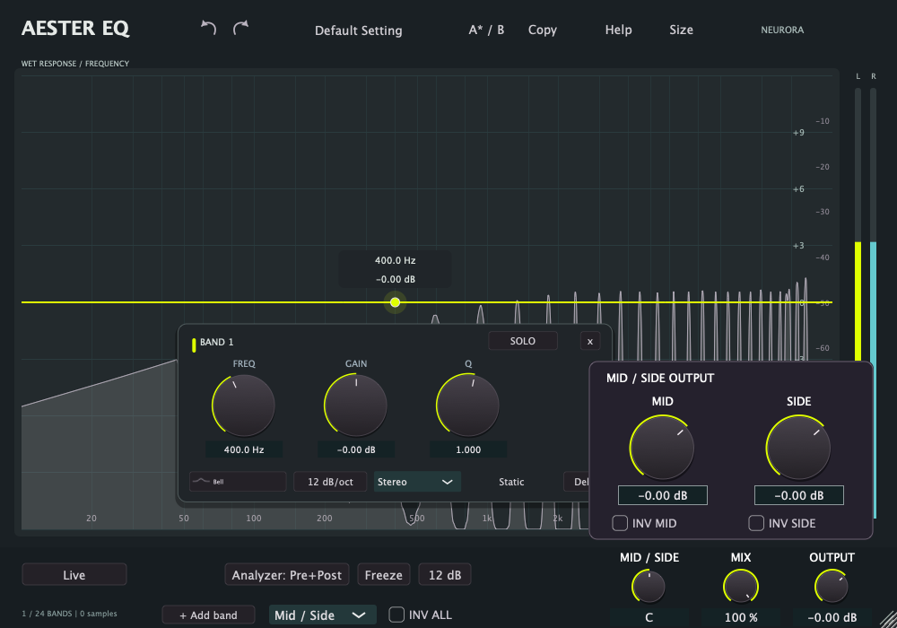

# Aester EQ by Neurora

A 24-band equalizer for focused tonal shaping, dynamic control and frequency-selective spectral processing.

A compact, resizable response workspace uses floating controls for the selected band and fluorescent yellow accents. The footer contains rotary Balance, Mix and Output controls. Selecting Mid / Side automatically opens independent component levels and polarity controls. [Focus UI and monitoring](docs/FOCUS_UI.md).

## Processing

- Ten filter shapes and up to 24 independent bands.
- Static, Dynamic and Spectral operation per band.
- Stereo, Left, Right, Mid and Side placement.
- Internal or external sidechain detection; independent detector cuts in Dynamic mode.
- Live IIR, Analog FIR and five Linear FIR resolutions.
- **Mix:** a smoothed, latency-aligned blend between dry and processed audio.
- **Freeze:** hold the spectrum display while processing and output meters continue.
- **Solo:** temporarily audition the selected frequency region with Q-linked bandwidth.
- Independent Mid/Side output gain and polarity after Mix.
- Pre/post/sidechain spectrum, output balance, polarity, presets, Undo/Redo and editor-local A/B.

The graph displays the **wet response before Mix**. Blending dry and wet can change the resulting frequency response because filter phase is part of the sum.

## Downloads

The macOS 1.2.0 package includes the Focus UI, Solo monitoring and independent Mid/Side output controls.

| Platform | Package | Status |
|---|---|---|
| macOS Apple Silicon | [Aester EQ 1.2.0 DMG](releases/Aester-EQ-Neurora-1.2.0-macOS-arm64.dmg) | Development preview: AU + standalone |
| Windows x64 | [Build status](https://github.com/neurorasolutions/Aester-EQ/actions/workflows/windows.yml) | VST3 + standalone; installer validation in progress |

Save your session and close your DAW before installing. Builds are unsigned for distribution; the Mac binaries are ad hoc signed and not notarized. Windows installation and DAW compatibility still need interactive verification. [Installation notes](docs/INSTALLATION.md).

## Technical character

Aester's static path uses linear filters: gain and bandwidth determine the tonal change rather than an intentional saturation stage. Dynamic mode changes filter gain from a level detector; Spectral mode uses a short-time Fourier transform to make frequency-selective changes. FIR modes introduce delay and, in linear phase, pre-ringing. This is a technical description, not a claim of perceptual transparency in every setting.

Read the [single-product technical evaluation](docs/TECHNICAL_EVALUATION.md), [test procedure](docs/TESTING.md), [user guide](docs/USER_GUIDE.md) and [build instructions](docs/BUILDING.md).

## Free and open source

Produced by [Neurora](https://www.neurora.it). Contributions and reproducible bug reports are welcome. Source is licensed under AGPL-3.0-only; retain all [third-party notices](THIRD_PARTY_NOTICES.md). Project licensing does not impose an additional non-commercial restriction.

This repository contains Aester EQ source, technical documentation and platform packages.
