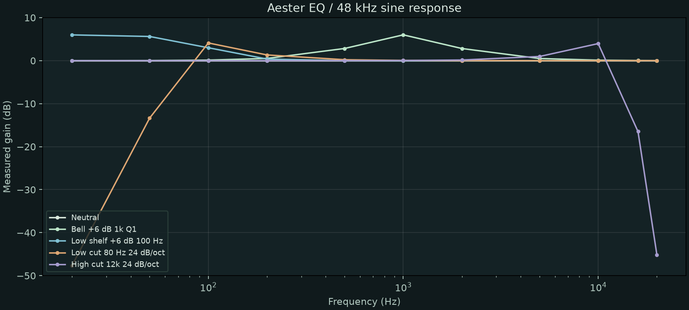

# Aester EQ technical evaluation

## Scope and conditions

This report evaluates Aester EQ alone. It contains no product ranking or claimed equivalence. Measurements were made on the macOS arm64 Release build at 48 kHz, stereo Float32, 128-sample processing blocks, with 0.05 peak sine input. Each tone is rendered for one second; complex amplitude is estimated over the final half second. Eleven discrete frequencies are used in each of five configurations (55 measurements total). Band Q is 1.0 for these fixtures. Output is 0 dB, Mix 100%, Live processing and dynamics off.

Symbols are measured points; joining lines are not a continuous sweep. These plots do not capture arbitrary narrow resonances between tones.

## Observed behavior

- Neutral gain deviation was at most 0.00000122 dB across the eleven measured tones. This is a bounded floating-point signal check, not a universal audibility claim.
- The +6 dB, 1 kHz Bell fixture measures approximately +6 dB at its center. The magnitude response returns toward unity away from the center.
- The low shelf raises the low-frequency region and approaches unity at high frequencies.
- Cut filters at Q 1.0 are resonant: the 80 Hz Low Cut fixture measures about +4.12 dB at 100 Hz, and the 12 kHz High Cut fixture about +3.97 dB at 10 kHz. Do not interpret these settings as maximally flat filters; lower Q changes their shape.
- All these Live static fixtures report zero added latency. This does not apply to FIR or Spectral modes.

## Phase, time behavior and sound

Static processing is based on linear filter sections and does not intentionally add saturation. Audible character depends on the selected magnitude/phase curve, resonance, source signal and gain staging. Dynamic processing changes gain over time; Spectral processing can produce modulation or temporal smearing at aggressive settings. No controlled listening panel has been conducted, so words such as warm, transparent or identical are not supported conclusions.

Analog FIR uses a finite complex-response kernel and 320 samples of delay. At 48 kHz the five Linear FIR resolutions report 3072 / 5120 / 9216 / 17408 / 66560 samples, with pre-ringing as a tradeoff. Spectral adds 1024 samples. Delay scales in some higher sample-rate FIR modes; test logs record exact fixtures.

Mix uses linear amplitude blending, not equal-power or dB interpolation. Eighteen impulse cases verify 0/50/100% blends in three phase modes with and without Spectral. Output gain, balance and polarity are included in the wet path. The dry path is aligned to processor latency; that removes gross time-offset combing but does not cancel the filter's own phase shift.

## Safety and practical limits

There is no output limiter or intentional loudness maximizer. Resonant boosts and summed bands can exceed 0 dBFS; use output attenuation. Neutrality and finite-output tests at their stated settings do not guarantee all parameter combinations are free of overload. Rapid FIR kernel changes, offline rendering, long-session CPU/memory, host automation and interactive Windows installation need broader qualification.

The allocation audit observes C++ heap operators during the tested callback fixtures. It is not a full system allocator audit or a cross-machine CPU benchmark. Tests of the shared processor are separate from native DAW format validation.

## Full amplitude measurements

| Configuration | Frequency (Hz) | Gain (dB) | Sample peak | Added latency (samples) |
|---|---:|---:|---:|---:|
| Neutral | 20 | -0.000001 | 0.05000000 | 0 |
| Neutral | 50 | -0.000001 | 0.05000000 | 0 |
| Neutral | 100 | -0.000001 | 0.05000000 | 0 |
| Neutral | 200 | -0.000001 | 0.05000000 | 0 |
| Neutral | 500 | -0.000001 | 0.05000000 | 0 |
| Neutral | 1000 | -0.000001 | 0.04999999 | 0 |
| Neutral | 2000 | -0.000001 | 0.05000000 | 0 |
| Neutral | 5000 | -0.000001 | 0.05000000 | 0 |
| Neutral | 10000 | -0.000001 | 0.05000000 | 0 |
| Neutral | 16000 | -0.000001 | 0.04330127 | 0 |
| Neutral | 20000 | -0.000001 | 0.05000000 | 0 |
| Bell +6 dB 1k Q1 | 20 | 0.005195 | 0.05002989 | 0 |
| Bell +6 dB 1k Q1 | 50 | 0.032439 | 0.05018691 | 0 |
| Bell +6 dB 1k Q1 | 100 | 0.129270 | 0.05074871 | 0 |
| Bell +6 dB 1k Q1 | 200 | 0.509288 | 0.05301848 | 0 |
| Bell +6 dB 1k Q1 | 500 | 2.831955 | 0.06926912 | 0 |
| Bell +6 dB 1k Q1 | 1000 | 5.999999 | 0.09976308 | 0 |
| Bell +6 dB 1k Q1 | 2000 | 2.823227 | 0.06901155 | 0 |
| Bell +6 dB 1k Q1 | 5000 | 0.496179 | 0.05286980 | 0 |
| Bell +6 dB 1k Q1 | 10000 | 0.116629 | 0.05049736 | 0 |
| Bell +6 dB 1k Q1 | 16000 | 0.041037 | 0.04441729 | 0 |
| Bell +6 dB 1k Q1 | 20000 | 0.026503 | 0.05014518 | 0 |
| Low shelf +6 dB 100 Hz | 20 | 5.989638 | 0.09964417 | 0 |
| Low shelf +6 dB 100 Hz | 50 | 5.623584 | 0.09553203 | 0 |
| Low shelf +6 dB 100 Hz | 100 | 2.999998 | 0.07062655 | 0 |
| Low shelf +6 dB 100 Hz | 200 | 0.376369 | 0.05221416 | 0 |
| Low shelf +6 dB 100 Hz | 500 | 0.010346 | 0.05003875 | 0 |
| Low shelf +6 dB 100 Hz | 1000 | 0.000645 | 0.04994241 | 0 |
| Low shelf +6 dB 100 Hz | 2000 | 0.000039 | 0.04998526 | 0 |
| Low shelf +6 dB 100 Hz | 5000 | 0.000001 | 0.04999776 | 0 |
| Low shelf +6 dB 100 Hz | 10000 | -0.000000 | 0.04999956 | 0 |
| Low shelf +6 dB 100 Hz | 16000 | -0.000001 | 0.04334757 | 0 |
| Low shelf +6 dB 100 Hz | 20000 | -0.000001 | 0.04999998 | 0 |
| Low cut 80 Hz 24 dB/oct | 20 | -47.631053 | 0.00020769 | 0 |
| Low cut 80 Hz 24 dB/oct | 50 | -13.356637 | 0.01074326 | 0 |
| Low cut 80 Hz 24 dB/oct | 100 | 4.117445 | 0.08032268 | 0 |
| Low cut 80 Hz 24 dB/oct | 200 | 1.328366 | 0.05826216 | 0 |
| Low cut 80 Hz 24 dB/oct | 500 | 0.220758 | 0.05126784 | 0 |
| Low cut 80 Hz 24 dB/oct | 1000 | 0.055343 | 0.05031211 | 0 |
| Low cut 80 Hz 24 dB/oct | 2000 | 0.013733 | 0.04994371 | 0 |
| Low cut 80 Hz 24 dB/oct | 5000 | 0.002066 | 0.04999158 | 0 |
| Low cut 80 Hz 24 dB/oct | 10000 | 0.000404 | 0.04999835 | 0 |
| Low cut 80 Hz 24 dB/oct | 16000 | 0.000079 | 0.04344063 | 0 |
| Low cut 80 Hz 24 dB/oct | 20000 | 0.000016 | 0.04999993 | 0 |
| High cut 12k 24 dB/oct | 20 | 0.000014 | 0.05000008 | 0 |
| High cut 12k 24 dB/oct | 50 | 0.000093 | 0.05000053 | 0 |
| High cut 12k 24 dB/oct | 100 | 0.000372 | 0.05000212 | 0 |
| High cut 12k 24 dB/oct | 200 | 0.001488 | 0.05000846 | 0 |
| High cut 12k 24 dB/oct | 500 | 0.009306 | 0.05005299 | 0 |
| High cut 12k 24 dB/oct | 1000 | 0.037273 | 0.05021276 | 0 |
| High cut 12k 24 dB/oct | 2000 | 0.149887 | 0.05086369 | 0 |
| High cut 12k 24 dB/oct | 5000 | 0.969901 | 0.05590064 | 0 |
| High cut 12k 24 dB/oct | 10000 | 3.968008 | 0.07836151 | 0 |
| High cut 12k 24 dB/oct | 16000 | -16.483590 | 0.00719195 | 0 |
| High cut 12k 24 dB/oct | 20000 | -45.143892 | 0.00027654 | 0 |

Sample peak is the largest discrete sample, not a reconstructed true-peak value. Full precision data: [CSV](data/aester-response.csv). Reproduction: build and run `characterize`; see [testing](TESTING.md).
